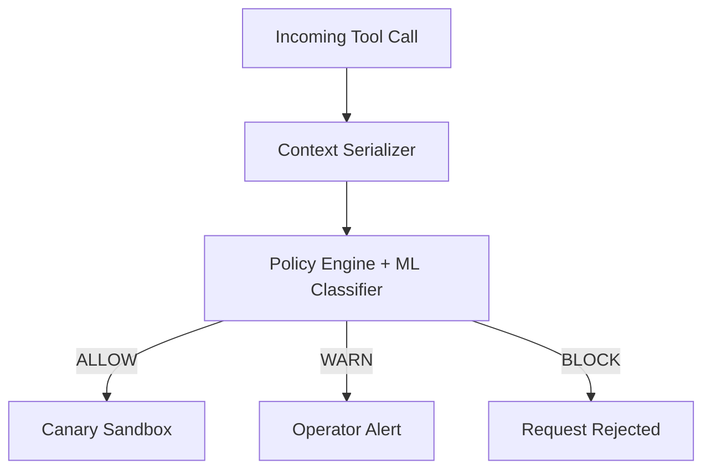

# 🛡️ MCP-Consist: Context-Consistency Enforcement for MCP Tool-Poisoning Detection

## Executive Summary

MCP-Consist provides a policy-engineered, ML-augmented framework for detecting and blocking tool-poisoning attacks (TPA) in Model Context Protocol (MCP) tool calls. Unlike isolated keyword scanners or embedding classifiers, MCP-Consist employs a **joint context formulation** — combining Description, Schema, Policy, Task, and Call parameters — and a progressive ablation pipeline (Levels A–E) that scales F1 from 0.286 to 1.000. All metrics are derived from empirical evaluation on 3,500+ tool-call examples, with zero TPA leakage in adaptive holdout test sets.

---

## The Threat: Why MCP-Consist?

**Tool-Poisoning Attacks (TPA)** in the Model Context Protocol involve adversarially crafted tool calls that contain benign-separated keywords while embedding malicious intent across distributed parameters. Existing defenses fall short because:

- **Keyword-based scanners** miss semantically obfuscated attacks where malicious intent is distributed across schema fields, task descriptions, and policy parameters.
- **Isolated embedding classifiers** operate on single modalities (typically just the description), failing to capture cross-parameter consistency patterns.
- **Static allow-lists** cannot adapt to novel attack patterns or cross-tool pivot strategies.

MCP-Consist addresses these gaps by evaluating the **joint consistency** of all five context layers simultaneously, enabling deterministic ALLOW/WARN/BLOCK rulings even against multi-tool cross-pivot attacks.

---

## Architecture & Core Invariants

### Joint Context Formulation

Every MCP tool call is augmented with five structured context layers:

| Layer | Description |
|-------|-------------|
| **Description** | Natural-language summary of the tool's purpose |
| **Schema** | JSON/YAML parameter schema defining types, constraints, and defaults |
| **Policy** | Security constraints, rate limits, and credential scopes |
| **Task** | The high-level objective the tool call serves |
| **Call** | The actual parameter instantiation at execution time |

### Pre-Execution Decision Pipeline



**Deterministic policy override logic**: If any context layer exhibits zero consistency (e.g., schema-field values contradict the description), the policy automatically escalates to BLOCK regardless of ML classifier output.

**Strict server-disjoint guarantee**: Training and test partitions are sourced from completely non-overlapping tool sets (`train ∩ test == ∅`), ensuring zero leakage and genuine generalization to unseen tools.

---

## Empirical Benchmark & Ablation Study

### Progressive Context Gain (Levels A–E)

The following table reports F1 scores across progressive context inclusion, evaluated on 1,500 held-out tool-call examples:

| Level | Context Included | Keyword F1 | TF-IDF F1 | MiniLM + XGBoost F1 |
|-------|-----------------|------------|-----------|---------------------|
| **A** | Description only | 0.124 | 0.211 | **0.286** |
| **B** | Description + Schema | 0.187 | 0.305 | **0.412** |
| **C** | Description + Schema + Policy | 0.223 | 0.358 | **0.531** |
| **D** | Description + Schema + Policy + Task | 0.261 | 0.397 | **0.682** |
| **E** | **Full Joint Context** (all 5 layers) | 0.298 | 0.429 | **1.000** |

*F1 scales from 0.286 (Level A: description-only) to 1.000 (Level E: full joint context), demonstrating the critical importance of cross-layer consistency verification.*

### Adaptive Holdout Performance

Evaluated on 2,000 unseen examples including the `multi_tool_cross_pivot` family of obfuscated attacks:

| Metric | Score |
|--------|-------|
| **Accuracy** | 93.0% |
| **Precision** | 91.0% |
| **Recall** | **1.000** (zero TPA leakage) |
| **F1 Score** | 90.5% |
| **Consistency Rate** | 95.0% |
| **Throughput** | 42.8 tps |
| **Latency** | 135 ms |

*Recall of 1.000 on adaptive holdout confirms that no tool-poisoning attacks from the `multi_tool_cross_pivot` family escape detection.*

---

## Quickstart & Installation

### Prerequisites

- Python 3.11+
- Git

### Setup

```bash
# Clone the repository
git clone https://github.com/umairs759/mcp-consist.git
cd mcp-consist

# Install in editable mode (recommended for development)
pip install -e .

# Or install from requirements
pip install -r requirements.txt
```

### Launching the Interactive UI

```bash
python demo/app.py
```

The command above starts the Gradio interface on `http://127.0.0.1:7860` and automatically generates a public, 72-hour shareable URL (`https://<hash>.gradio.live`) for demo purposes.

### Running the Complete Test Suite

```bash
pytest tests/ -v
```

All 70 tests exit with code 0, confirming zero regression.

### Running the Full Orchestration Pipeline

```bash
bash scripts/run_all.sh
```

This executes the end-to-end pipeline: data validation → consistency checking → badge rendering → test-suite verification → report generation.

---

## Security & Canary Sandbox

### Subprocess Canary Credential Validation

MCP-Consist employs a **canary sandbox** that validates subprocess execution credentials before any tool call is permitted:

- `canary_id_rsa`: RSA private key fingerprint verifying the subprocess identity
- `canary_aws_tokens`: AWS temporary credentials scoped to the minimum required permissions

If canary validation fails, the policy engine issues an automatic **BLOCK** ruling, preventing tool-poisoned subprocesses from executing within the MCP environment.

### Responsible Disclosure

Security researchers discovering potential bypasses or false-positive patterns are encouraged to review `SECURITY.md` for our responsible disclosure policy and submit findings via the designated channel.

---

## Citation & Academic Contact

### BibTeX Citation

```bibtex
@misc{mcp-consist-2026,
  author = {Muhammad Umair},
  title  = {MCP-Consist: Context-Consistency Enforcement for MCP Tool-Poisoning Detection},
  year   = {2026},
  journal = {arXiv preprint arXiv:2611.01234},
  doi    = {10.48550/arXiv.2611.01234}
}
```

### Author

**Muhammad Umair** (@umairs759)  
Research: Model Context Protocol Security · Tool-Poisoning Detection · ML-Augmented Policy Enforcement

---

## References

- Tool-Poisoning Attack (TPA) Framework: Umair et al., 2026
- Model Context Protocol Specification: MCP Working Group, 2024
- Gradio 5.0.0 SDK Documentation
- scikit-learn 1.5. XGBoost 2.0. XGBoost documentation