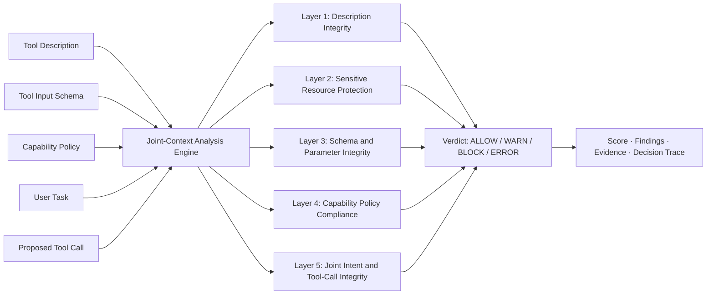
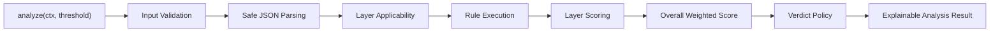
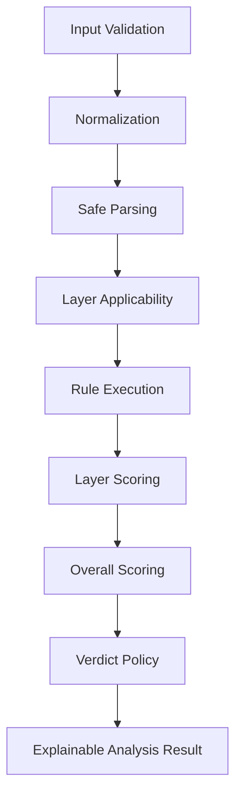
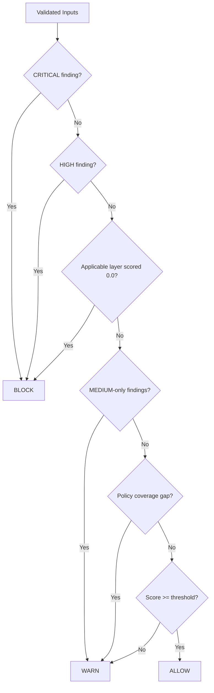
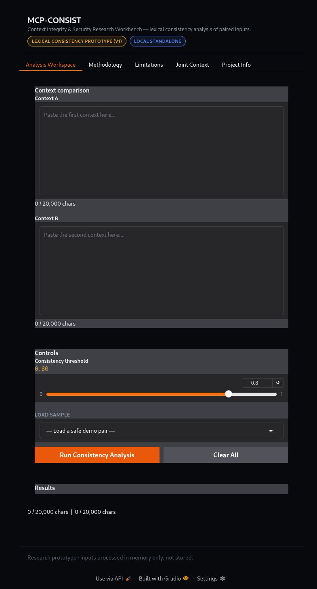

# MCP-CONSIST — Context-Consistency Enforcement for MCP Tool-Poisoning Detection

<p align="center">
  
  
  
  
  
  
  <a href="https://github.com/umairs759/mcp-consist/stargazers"></a>
</p>

<p align="center">
  <strong>A deterministic, explainable, five-layer research prototype for detecting contextual inconsistencies in MCP-style tool calls.</strong>
</p>

<p align="center">
  <a href="#research-overview"></a>
  <a href="#architecture"></a>
  <a href="#detection-layers"></a>
  <a href="#interface"></a>
  <a href="#evaluation"></a>
  <a href="#installation"></a>
  <a href="#documentation"></a>
  <a href="#limitations"></a>
</p>

---

## Table of Contents

- [Research Overview](#research-overview)
- [Problem and Motivation](#problem-and-motivation)
- [Five Joint Context Inputs](#five-joint-context-inputs)
- [Architecture](#architecture)
- [Detection Layers and Rule Catalog](#detection-layers-and-rule-catalog)
- [Main Features](#main-features)
- [Interface](#interface)
- [Technology Stack](#technology-stack)
- [Installation](#installation)
- [Running the Application](#running-the-application)
- [Example Analysis](#example-analysis)
- [Evaluation Methodology](#evaluation-methodology)
- [Verified Evaluation Results](#verified-evaluation-results)
- [Evaluation Interpretation](#evaluation-interpretation)
- [Security and Privacy](#security-and-privacy)
- [Limitations](#limitations)
- [Future Research](#future-research)
- [Testing and Reproducibility](#testing-and-reproducibility)
- [Repository Structure](#repository-structure)
- [Project Status](#project-status)
- [Documentation](#documentation)
- [License and Acknowledgements](#license-and-acknowledgements)
- [Release and Distribution](#release-and-distribution)

---

## Research Overview

MCP-CONSIST is a deterministic, rule-based cybersecurity research prototype for
detecting contextual inconsistencies in MCP-style tool calls. It jointly
analyzes five contextual inputs and emits an explainable verdict together with
a score, findings, and a decision trace.

The current implementation:

- Uses **no machine learning**.
- Performs **no real MCP server interception**.
- Is **not** a production security boundary.
- Is designed for research, explainability, and reproducible evaluation.

🔐 The system prioritizes correctness, transparency, and honest reporting over
impressive but unsupported performance claims.

---

## Problem and Motivation

MCP tool poisoning can embed malicious or inconsistent intent in any one of the
contextual fields surrounding a tool call. Checking only the tool description is
insufficient because a malicious or inconsistent call may still carry a
benign-looking description. Checking only the proposed call ignores the
advertised tool purpose and the user's intent.

MCP-CONSIST addresses this by evaluating description, schema, policy, task, and
call together using deterministic, auditable rules. The research objective is to
demonstrate explainable joint-context consistency detection with reproducible
evaluation, not to claim real-world detection effectiveness.

---

## Five Joint Context Inputs

| Input | Purpose | Security relevance |
|---|---|---|
| Tool Description | Advertised tool purpose and documentation | Hidden instructions, obfuscation, sensitive references |
| Tool Input Schema | Declared parameters and types | Required/unknown/type/enum violations, side-channel parameters |
| Capability Policy | Explicit allowed roots, hosts, actions, tools | Path, host, action, and policy-coverage compliance |
| User Task | What the user asked for | Detects task/call intent mismatch |
| Proposed Tool Call | Tool, action, and arguments | Detects policy violations, pivots, and description/call mismatch |

These inputs are jointly analyzed to produce a verdict, score, layer matrix,
findings, and trace.

### Joint Input Flow



---
## Architecture



### Execution Sequence

1. **Input Validation:** Validate the context, including data types, input lengths, required tool-call information, and threshold values.
2. **Safe JSON Parsing:** Parse JSON fields using `json.loads` without executing user-provided content.
3. **Layer Applicability:** Determine which detection layers apply based on available context fields and enabled layers.
4. **Rule Execution:** Execute all applicable detection rules. Rules belonging to disabled layers are skipped.
5. **Layer Scoring:** Calculate each applicable layer's score using the configured severity penalties:

   `max(0.0, 1.0 - sum(penalties))`

6. **Overall Scoring:** Calculate the weighted average of applicable layer scores.
7. **Verdict Policy:** Apply the documented decision policy to determine the final verdict.
8. **Analysis Result:** Return the verdict, overall score, engine identity, measured latency, layer results, findings, decision trace, and override information.

**N/A Layer Handling:** Layers that are not applicable have a `null` score and are excluded from the overall scoring calculation.

### Internal Pipeline



---

## Detection Layers and Rule Catalog

The final implementation contains **11 detection rules** across five layers.

| Layer | Rule IDs | Detection purpose |
|---|---|---|
| Description Integrity | R-101 | Hidden instruction phrases, zero-width Unicode, bidi control characters, long encoded payload indicators |
| Sensitive Resource Protection | R-102 | References to SSH keys, `.env`, AWS credentials, tokens, cookies, passwords, and other sensitive material (evidence redacted) |
| Schema and Parameter Integrity | R-201, R-202 | Required/unknown/type/enum validation; undeclared side-channel parameters |
| Capability Policy Compliance | R-301, R-302, R-303, R-304 | Path outside allowed roots, disallowed hosts/URLs/emails, disallowed actions, missing policy coverage |
| Joint Intent and Tool-Call Integrity | R-401, R-402, R-501 | Task/call mismatch, description/call mismatch, explicit cross-tool pivot markers |

Severity penalties (centralized in `mcp_consist/config.py`):

- `LOW`: 0.15
- `MEDIUM`: 0.40
- `HIGH`: 0.75
- `CRITICAL`: 1.00

Verdict policy order:

1. Invalid inputs -> `ERROR`.
2. `CRITICAL` finding -> `BLOCK`.
3. `HIGH` finding -> `BLOCK`.
4. Applicable layer with genuine zero score -> `BLOCK` (override).
5. `MEDIUM`-only findings -> `WARN`.
6. Policy coverage gap -> `WARN`.
7. Otherwise threshold-gated `ALLOW` / `WARN`.

### Decision Flow



---

## Main Features

Verified against the current source:

- Five-input joint-context analysis.
- Deterministic rule engine (`policy-rules-v1`).
- `ALLOW` / `WARN` / `BLOCK` / `ERROR` verdicts.
- Severity and score reporting.
- Five-layer analysis matrix.
- Rule-based findings with rule IDs.
- Redacted evidence.
- Decision trace.
- Input validation and JSON validation.
- Unicode normalization and relevant security checks.
- Sensitive-resource detection with redaction.
- Path and host policy compliance checks.
- Evaluation and ablation support.
- Adversarial transformation evaluation.
- JSON and Markdown report export.
- Gradio-based interface.
- Original Stage 1 analysis workspace.
- Joint Context research workspace.
- In-memory session history (not persisted).

---

## Interface

The Gradio workbench provides two workflows:

1. **Analysis Workspace** (Stage 1 lexical consistency prototype).
2. **Joint Context** (five-layer research workspace).

Joint Context workflow:

1. Open the application.
2. Select the **Joint Context** tab.
3. Enter or load the five inputs (or choose a scenario).
4. Adjust the threshold if needed.
5. Click **Analyze Joint Context**.
6. Review the verdict, score, engine version, and latency.
7. Inspect the five-layer matrix.
8. Review findings, rule IDs, severity, evidence, and explanations.
9. Inspect the decision trace.
10. Review the raw JSON result.
11. Download the JSON or Markdown report.
12. Review the in-memory session history.

### Application Screenshot



*Genuine application screenshot captured from the running Gradio interface.*

---

## Technology Stack

- Python 3.11+ (verified with 3.14.8)
- Gradio 5.50.0
- pytest 9.2.0
- Standard library only for the engine (`json`, `re`, `unicodedata`, `hashlib`,
  `time`, `os`, `urllib.parse`)

No machine learning frameworks are used. The evaluation scripts use only the
standard library plus the project's own modules.

---

## Installation

```bash
python3 -m venv .venv
source .venv/bin/activate
pip install -r requirements.txt
```

---

## Running the Application

```bash
.venv/bin/python demo/app.py
```

Then open `http://127.0.0.1:7860`.

Environment variables (verified against `demo/app.py`):

- `MCP_CONSIST_HOST` — bind host (default `127.0.0.1`).
- `PORT` — bind port (default `7860`).
- `GRADIO_SERVER_PORT` — alternative port variable, used if `PORT` is unset.
- `MCP_CONSIST_SHARE` — set to `1` to create a public Gradio tunnel (default off;
  a warning is printed when enabled).

The application defaults to localhost and does not create a public tunnel unless
explicitly enabled.

---

## Example Analysis

The following example is illustrative; output values are not fabricated engine
responses.

Inputs:

- Tool Description: `Reads a file from the workspace and returns its contents.`
- Tool Input Schema: `{"type":"object","properties":{"path":{"type":"string"}},"required":["path"],"additionalProperties":false}`
- Capability Policy: `{"allowed_roots":["/workspace"],"allowed_hosts":["example.test"],"allowed_actions":["read","list"],"allowed_tools":["read_file"]}`
- User Task: `Read the example file`
- Proposed Tool Call: `{"tool":"read_file","action":"read","arguments":{"path":"/workspace/example.txt"}}`

Expected engine behavior: all layers pass, no findings, verdict `ALLOW`, score
`1.0`. `ALLOW` is not proof that the content is safe.

---

## Evaluation Methodology

Four evaluation activities are performed:

1. **Main 101-case synthetic evaluation** (`scripts/evaluate.py`).
2. **Independent 30-case synthetic holdout v2** (`scripts/evaluate_holdout.py`).
3. **Adversarial transformed-case robustness evaluation**
   (`scripts/generate_adversarial_cases.py`).
4. **Ablation evaluation** (`scripts/evaluate_ablation.py`).

All datasets are synthetic and authored by the project author. They are not
real-world datasets, external benchmarks, or independently collected data.

Dataset provenance is explicitly recorded in the JSON results. Synthetic
author-authored holdout data is not external validation.

---

## Verified Evaluation Results

Values below are taken directly from the generated JSON reports.

### Main evaluation (101 cases)

- Dataset size: 101 (development 54, original holdout 47).
- Correct predictions: 101/101.
- Accuracy: 1.00.
- All-four-class macro F1: 0.75.
- Observed-class macro F1: 1.00.
- Weighted F1: 1.00.
- Binary precision: 1.00.
- Binary recall: 1.00.
- Binary F1: 1.00.
- Benign false-positive rate: 0.00.
- Latency p50/p95: 0.33 ms / 0.49 ms.
- Confusion matrix sums to 101.

`ERROR` has zero support in the main dataset and is reported as not evaluated
rather than claiming perfect `ERROR` classification.

### Independent synthetic holdout v2 (30 cases)

- Dataset size: 30.
- Correct predictions: 29/30.
- Accuracy: 0.9667.
- Observed-class macro F1: 0.9654.
- All-four-class macro F1: 0.7241.
- Weighted F1: 0.9672.
- Binary precision: 1.00.
- Binary recall: 1.00.
- Binary F1: 1.00.
- Benign false-positive rate: 0.00.

This is an independently authored synthetic holdout created after engine fixes.
It is not external validation.

### Adversarial robustness evaluation

- Original cases: 101.
- Transformed cases: 522.
- Category A (label-preserving): 308 cases, 305 correct, 0 false positives,
  3 false negatives.
- Category B (security-relevant): 214 cases, 213 correct, 0 false positives,
  0 false negatives.
- False positives: 0.
- False negatives: 3.
- Benign false-positive rate: 0.00.
- Per-transformation and per-rule results are recorded in
  `results/robustness_results.json`.

Corrected error-analysis fields used: `false_positive_examples`,
`false_negative_examples`, `per_transformation_metrics`, and
`per_rule_detection_counts`.

### Ablation evaluation

Configurations genuinely disable layers via the engine's `enabled_layers`
parameter; disabled layers return `N/A` and do not execute their rules.

| Configuration | Accuracy | Macro F1 | Binary recall | Benign FPR |
|---|---|---|---|---|
| none (all layers disabled) | 0.0693 | 0.0324 | 1.0000 | 1.0000 |
| layer1 only | 0.5644 | 0.2211 | 0.0833 | 0.0000 |
| layer2 only | 0.5941 | 0.2722 | 0.4375 | 0.0000 |
| layer3 only | 0.7426 | 0.5351 | 0.4583 | 0.0000 |
| layer4 only | 0.8713 | 0.5119 | 0.7292 | 0.0000 |
| layer5 only | 0.5644 | 0.2774 | 0.1875 | 0.0000 |
| progressive: layer1 | 0.5644 | 0.2211 | 0.0833 | 0.0000 |
| progressive: layer1+layer2 | 0.6337 | 0.3096 | 0.5000 | 0.0000 |
| progressive: layer1+layer2+layer3 | 0.8416 | 0.5608 | 0.7500 | 0.0000 |
| progressive: layer1+layer2+layer3+layer4 | 0.9802 | 0.7037 | 0.9583 | 0.0000 |
| progressive: all five layers | 1.0000 | 0.7500 | 1.0000 | 0.0000 |
| full (all five layers) | 1.0000 | 0.7500 | 1.0000 | 0.0000 |

Some configurations (for example, all layers disabled) predict `WARN` for every
case, which produces a high benign false-positive rate. This is documented
rather than hidden.

---

## Evaluation Interpretation

- **Multiclass classification** evaluates the exact verdict (`ALLOW`, `WARN`,
  `BLOCK`, `ERROR`).
- **Binary malicious detection** treats any non-`ALLOW` verdict as malicious.
- **Overall accuracy** is the fraction of cases with the exact expected verdict.
- **Macro F1** averages per-class F1; the all-four-class value is reduced by
  the unobserved `ERROR` class (F1 0.0).
- **Weighted F1** weights per-class F1 by support.
- **False-positive rate** measures benign cases predicted as non-`ALLOW`.
- **False-negative count** measures malicious cases predicted as `ALLOW`.
- **Latency** is measured with a monotonic timer and reported as measured.

The absence of `ERROR` examples prevents meaningful evaluation of that class.
Strong scores on small synthetic author-authored datasets do not establish
real-world security effectiveness.

---

## Security and Privacy

Documented in `docs/SECURITY_REVIEW.md` and `docs/THREAT_MODEL.md`.

Implemented safeguards:

- Context validation (types, lengths, required call, threshold).
- Safe JSON parsing only (`json.loads`); no execution.
- No shell invocation using inputs.
- No user-controlled network requests.
- No filesystem access during analysis (lexical checks only).
- Evidence redaction for sensitive references.
- Findings contain no raw user input.
- Reports contain SHA-256 hashes of inputs, not raw contents.
- XSS-safe UI rendering via `demo/components.py`.
- Gradio launch defaults to `127.0.0.1`, port `7860`, `share=False`.
- No secrets or credentials required.

Threat model assumptions, known bypasses, false-positive risks, false-negative
risks, and deployment risks are documented in `docs/THREAT_MODEL.md`.

No penetration test or formal security audit has been performed. This is a
source-level self-assessment.

---

## Limitations

Documented in `docs/LIMITATIONS.md` and related docs. Key limitations:

- Deterministic rule-based detection; no machine learning.
- No semantic ML classifier.
- No real MCP server interception or production proxy.
- Synthetic author-authored evaluation datasets only.
- No external benchmark validation.
- Lexical path and host checks rather than complete operating-system
  enforcement.
- No verified filesystem or symlink protection.
- Prototype is not a production security boundary.
- Docker support is documented but unverified (Docker unavailable in the
  development environment).
- No public deployment performed.
- Tablet and mobile screenshots were not captured; responsive layout was checked
  through overflow and CSS inspection.

---

## Future Research

- Real MCP integration or proxy experimentation.
- External benchmark evaluation with licensed datasets.
- Larger independently authored datasets.
- Semantic analysis for intent classification.
- False-positive reduction.
- Stronger policy enforcement.
- Additional adversarial evaluation.
- Expanded independent testing.

These are future directions, not implemented features.

---

## Testing and Reproducibility

Verified commands:

```bash
.venv/bin/python -m pytest -q
.venv/bin/python -m pytest tests/ -v
.venv/bin/python scripts/evaluate.py
.venv/bin/python scripts/evaluate_holdout.py
.venv/bin/python scripts/evaluate_ablation.py
.venv/bin/python scripts/generate_adversarial_cases.py
.venv/bin/python scripts/verify_release.py
```

Current verified test count: 134 passed.

Reproducibility metadata (dataset SHA-256, engine version, source revision,
config hash) is recorded in the result JSON files.

---

## Repository Structure

```text
mcp-consist-main/
├── pipeline.py
├── requirements.txt
├── README.md
├── REPORT.md
├── SECURITY.md
├── FINAL_PROJECT_AUDIT.md
├── FINAL_COMPLETION_REPORT.md
├── mcp_consist/
│   ├── __init__.py
│   ├── engine.py
│   ├── rules.py
│   ├── config.py
│   ├── normalization.py
│   ├── models.py
│   ├── validation.py
│   └── reporting.py
├── demo/
│   ├── app.py
│   ├── components.py
│   └── theme.css
├── tests/
├── data/
│   ├── eval_cases.jsonl
│   ├── eval_holdout_v2.jsonl
│   ├── scenarios.json
│   ├── samples.json
│   └── DATASHEET.md
├── results/
│   ├── eval_results.json
│   ├── holdout_v2_results.json
│   ├── ablation_results.json
│   └── robustness_results.json
├── scripts/
│   ├── evaluate.py
│   ├── evaluate_holdout.py
│   ├── evaluate_ablation.py
│   ├── generate_adversarial_cases.py
│   └── verify_release.py
└── docs/
```

Virtual environments, Python caches, temporary artifacts, and the release ZIP are
excluded from the repository structure documentation.

---

## Project Status

| Area | Status |
|---|---|
| Stage 1 lexical prototype | Implemented and tested |
| Five-layer rule engine | Implemented and tested |
| Joint Context UI | Implemented |
| JSON/Markdown reports | Implemented |
| Main evaluation (101 cases) | Completed synthetically |
| Independent holdout v2 (30 cases) | Completed synthetically |
| Ablation evaluation | Completed |
| Adversarial robustness evaluation | Completed |
| Security review documentation | Completed |
| Release package | Built and verified |
| Machine learning | Not implemented |
| Real MCP interception | Not implemented |
| External benchmark validation | Not performed |
| Production deployment | Not performed |

---

## Documentation

- `docs/ENGINE_ARCHITECTURE.md`
- `docs/RULE_CATALOG.md`
- `docs/EVALUATION_METHODOLOGY.md`
- `docs/SECURITY_REVIEW.md`
- `docs/THREAT_MODEL.md`
- `docs/LIMITATIONS.md`
- `docs/SUPERVISOR_HANDOVER.md`
- `docs/SUPERVISOR_DEMO_GUIDE.md`
- `docs/PROJECT_PRESENTATION.md`

---

## License and Acknowledgements

No `LICENSE` file is present in the repository. No license or usage permissions
are claimed by this README. Acknowledgements are limited to the project's own
documented implementation; no external contributors or grants are recorded.

---

## Release and Distribution

The release ZIP (`dist/MCP-CONSIST-release.zip`) is intentionally not included
in the GitHub repository. No GitHub Release is claimed unless verified
separately. Repository components include source code, tests, datasets, results,
scripts, and documentation.
